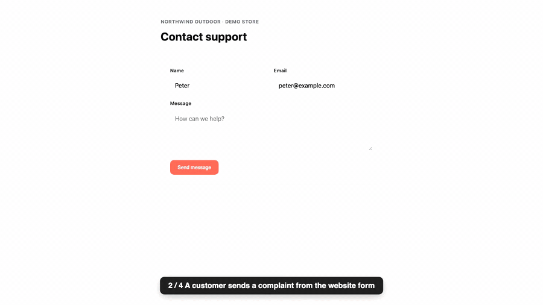
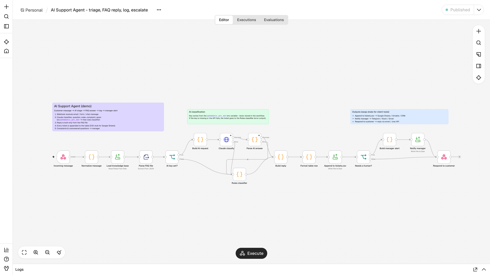
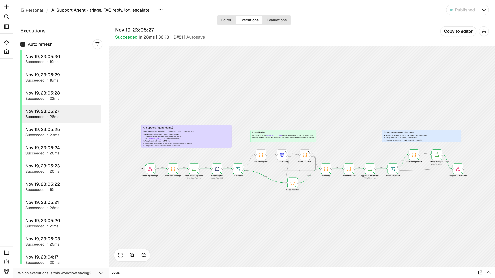
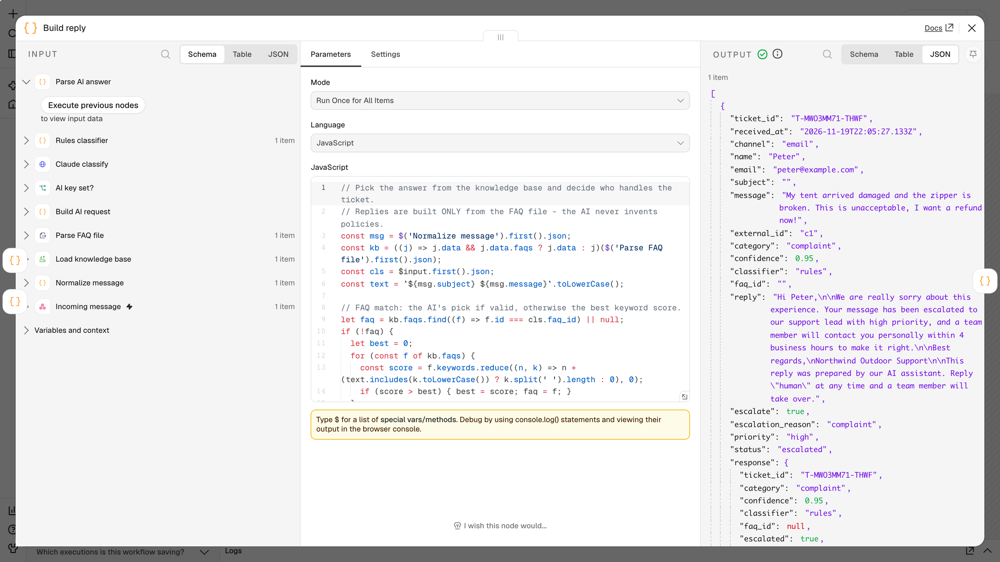

# AI Support Agent on n8n

An n8n workflow that answers customer messages on its own. It reads a message from email, a website form or a chat widget, decides what kind of message it is (**question / order / complaint / spam**), replies from your **FAQ file**, logs every ticket to a **table**, and sends **complaints to a manager** right away.



▶️ **Full demo video (47 s).** It shows the workflow, a customer complaint sent from a website form, the run in n8n, and 10 test messages arriving in the ticket table.

https://github.com/user-attachments/assets/45f6d8d3-4fed-46cb-8cb4-60ed6dbd7df7



## What it does

```
Customer message (webhook: email / form / chat)
        │
        ▼
Normalize message ──► Load knowledge base (faq.json)
        │
        ▼
AI key set? ──yes──► Claude classifies (category, confidence, FAQ id)
        │                    │ API error / bad answer
        no                   ▼
        └──────────► Rules classifier (free, offline, EN + DE)
                             │
                             ▼
                 Build reply (only from the FAQ, plus AI disclosure)
                             │
                             ▼
             Append row to tickets table (CSV stub for Google Sheets)
                             │
                 Needs a human? (complaint / no confident answer)
                     │yes                           │no
                     ▼                              │
           Notify manager (alert stub) ─────────────┤
                                                    ▼
                                      Respond to customer (JSON reply)
```

| Category  | What happens |
|-----------|--------------|
| question  | Answer taken from the matching FAQ entry. If no entry fits, the customer gets a polite holding reply and a human takes over |
| order     | Order request is logged and confirmed, and the team gets the details |
| complaint | Apology reply, **high-priority alert to the manager**, status `escalated` |
| spam      | No reply, logged as `ignored_spam` |

Design choices clients care about:
- **The AI never invents policies.** Claude only classifies the message and picks an FAQ entry. The reply text always comes from your FAQ file.
- **No key? Still works.** Without `ANTHROPIC_API_KEY`, or when the API fails, a rules classifier takes over automatically through the node's error output.
- **Secrets stay out of the workflow.** The key is read from an environment variable and is never stored in `workflow.json`.
- **EU AI Act ready.** Every reply says it was prepared by an AI assistant and offers a human.

## Files

| Path | What it is |
|------|------------|
| `workflow.json` | The workflow to import into n8n |
| `knowledge_base/faq.json` | FAQ, reply templates, manager contact. Edit this per client |
| `test_run.py` | Sends 10 test messages and checks reply, table row and manager alert |
| `run_n8n.sh` | Starts local n8n on 127.0.0.1 and imports/activates the workflow on first run |
| `demo/contact_form.html`, `demo/tickets.html` | Demo website form and live ticket table |
| `src/*.js`, `tools/build_workflow.py` | Code-node sources and the script that builds `workflow.json` |
| `tools/mock_claude.py` | Local fake Claude API to test the AI branch without a key or cost |

## Run it locally (5 minutes)

Requirements: Node.js 24 or newer, Python 3.9 or newer.

```bash
npm install            # installs n8n 2.48 into ./node_modules (~4 GB on disk, free, no account)
./run_n8n.sh           # http://127.0.0.1:5678, bound to localhost only
python3 test_run.py    # expect: 10/10 passed
```

On first launch, n8n asks you to create a **local** owner login. It is stored only in `.n8n-local/`. No n8n cloud account is needed.

Demo pages (optional):
```bash
python3 -m http.server 8765 --bind 127.0.0.1
# open http://127.0.0.1:8765/demo/contact_form.html and http://127.0.0.1:8765/demo/tickets.html
```

Turn on the AI classifier:
```bash
cp .env.example .env   # put your key in ANTHROPIC_API_KEY, then restart ./run_n8n.sh
python3 test_run.py --expect-classifier ai
```

Test the AI branch without a key or any cost, using the local fake API:
```bash
python3 tools/mock_claude.py &
ANTHROPIC_API_KEY=test AI_BASE_URL=http://127.0.0.1:8799 ./run_n8n.sh
python3 test_run.py --expect-classifier ai      # 10/10, classifier = ai:claude-opus-5-5
```
If the AI API is down (for example `AI_BASE_URL` points to a dead port), every ticket falls back to the rules classifier and the test still passes with `--expect-classifier rules`.

## Import into an existing n8n (client setup)

1. In n8n, open **Workflows → Import from file** and choose `workflow.json`. On self-hosted n8n you can also run `n8n import:workflow --input=workflow.json`.
2. Set these environment variables on the n8n server:

   | Variable | Example | Needed |
   |----------|---------|--------|
   | `ANTHROPIC_API_KEY` | `sk-ant-...` | optional; without it, the rules classifier is used |
   | `AI_MODEL` | `claude-opus-5-5` | optional |
   | `SUPPORT_KB_FILE` | `/data/knowledge_base/faq.json` | yes |
   | `SUPPORT_DATA_DIR` | `/data/output` | yes, while you use the file stubs |
   | `N8N_BLOCK_ENV_ACCESS_IN_NODE` | `false` | yes, so nodes can read the variables above |
   | `N8N_RESTRICT_FILE_ACCESS_TO` | `/data/knowledge_base;/data/output` | yes, while you use the file stubs |

3. Replace the stubs with the client's tools:
   - **Append to tickets.csv** → Google Sheets "Append row", Airtable or a CRM node.
   - **Notify manager** → Telegram, Slack or Gmail node (the alert text is built in *Build manager alert*).
   - **Incoming message** → point the client's form, help desk or email parser (Gmail trigger, IMAP, Zapier, Typeform) at the webhook URL `POST /webhook/support-inbox` with JSON `{name, email, message, channel}`.
   - **Respond to customer** → also send the reply by email or chat API if needed.
4. Edit `faq.json`: company name, signature, FAQ entries (question, keywords, answer) and templates.
5. Activate the workflow, then run `python3 test_run.py --url https://<client-n8n>/webhook/support-inbox --data-dir <output dir>`.

On production n8n you can store the key as an n8n **Header Auth credential** instead of an env variable: in the *Claude classify* node, switch authentication to that credential.

## Webhook API

`POST /webhook/support-inbox`
```json
{ "name": "Peter", "email": "peter@example.com", "channel": "email",
  "message": "My tent arrived damaged and the zipper is broken." }
```
Response:
```json
{ "ticket_id": "T-MHX2K1-7QZP", "category": "complaint", "confidence": 0.95,
  "classifier": "rules", "faq_id": null, "escalated": true, "status": "escalated",
  "reply": "Hi Peter, We are really sorry about this experience..." }
```

## Test results

`python3 test_run.py` sends 10 messages: 3 questions (EN and DE), 3 orders, 2 complaints and 2 spam. For each one it checks the category, the FAQ match, the reply and the AI disclosure, the table row, and that a manager alert is sent only for complaints.

| Mode | Result |
|------|--------|
| No key (rules classifier) | 10/10 |
| AI branch (local fake Claude API) | 10/10 |
| Key set, API unreachable (falls back to rules) | 10/10 |




## License
MIT. See [LICENSE](LICENSE).
